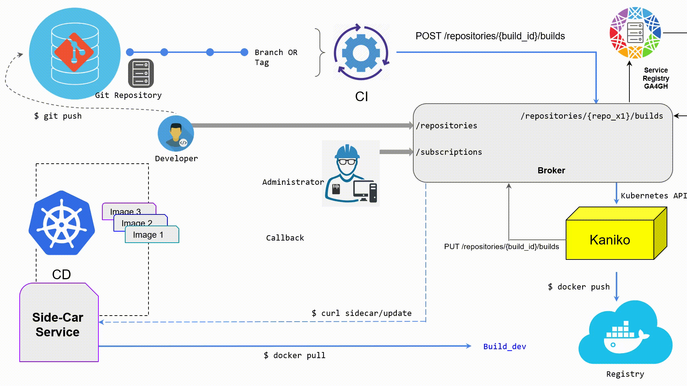

# Pubgrade

--8<-- "README.md:synopsis"

## Quick start

--8<-- "README.md:quick-start"

## Contents

- [Usage](usage.md): register repositories, users and subscriptions, publish
  images, and follow the notifications.
- [Deployment](deployment.md): the Helm chart for Kubernetes and OpenShift,
  the configuration, builds, and moving from chart 0.1.
- [API](api.md): the OpenAPI specification and its web interface.
- [Development](development.md): tests, CI, images and the documentation.
- [Pubgrade-Sidecar](sidecar/index.md): the subscriber that updates the image
  of a Kubernetes Deployment, documented in its own repository.

## License

This project is covered by the [Apache License
2.0](https://www.apache.org/licenses/LICENSE-2.0) also [shipped with this
repository](https://github.com/elixir-cloud-aai/Pubgrade/blob/dev/LICENSE).

## Contact

The project is a collaborative effort under the umbrella of [ELIXIR
On-Cloud](https://elixir-on.cloud/). Follow the link to get in touch with us
via chat or email. Please mention the name of this service for any inquiry,
proposal, question etc.
